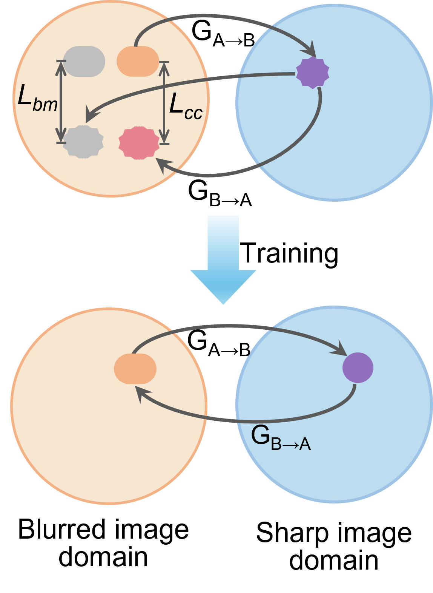

# BCGAN: 模糊形态学约束 CycleGAN (Blurred-Morphology-Constrained CycleGAN)

[](https://opensource.org/licenses/MIT)
[](https://www.python.org/downloads/)
[](https://pytorch.org/)

论文官方 PyTorch 实现代码库：  
**"Motion-blur-tolerant imaging flow cytometry extends the throughput–sensitivity frontier"**  
模型全称：**BCGAN (Blurred-Morphology-Constrained CycleGAN)**

[English](README.md) | [中文说明](README_CN.md)

---

## 方法原理与网络架构 (Method Overview)

<p align="center">
  
</p>

<p align="center">
  <em>循环一致性损失（$\mathcal{L}_{\text{cc}}$）与模糊形态学损失（$\mathcal{L}_{\text{bm}}$）形成紧密互补约束，兼顾图像去模糊恢复质感与生物测量形态保真度。</em>
</p>

---

## 1. 系统要求 (System Requirements)

### 操作系统与基础依赖
* **测试通过的操作系统 (Tested Operating System)**：
  * Windows 10 / 11 64 位
* **核心软件依赖环境**：
  * Python >= 3.10
  * PyTorch >= 2.0.0
  * Torchvision >= 0.15.0
  * 其余依赖见 [`requirements.txt`](requirements.txt)

### 测试与实验硬件环境 (Hardware Tested)
* **论文训练与主要实验工作站配置**：
  * CPU: Intel Core i7-12700K
  * GPU: NVIDIA GeForce RTX 4090 (24 GB 显存)
  * 内存: 32 GB RAM
* **推理与演示 Demo 硬件兼容性**：
  * 支持 NVIDIA GPU 加速（`--gpu_ids 0`）与标准 CPU 推理（`--gpu_ids -1`）。

---

## 2. 安装指南 (Installation Guide)

### 分步安装指令

```bash
# 1. 克隆代码库
git clone https://github.com/lbsiuhr/BCGAN.git
cd BCGAN

# 2. 创建并激活 Conda 环境
conda create -n bcgan python=3.10 -y
conda activate bcgan

# 3. 安装 PyTorch（以 CUDA 11.8 为例，亦可安装 CPU 版本）
pip install torch torchvision --index-url https://download.pytorch.org/whl/cu118

# 4. 安装其他依赖项
pip install -r requirements.txt
```

### 预估安装时间 (Typical Install Time)
* 在常规桌面电脑及正常网络环境下，完整安装过程约需 **5–10 分钟**。

---

## 3. 演示教程 (Demo)

代码库内已内置**样本数据集**（`jurkat_mini_sample`）及**预训练去模糊模型**，支持开箱即用快速验证。

### 内置演示资产
* **预训练模型 ($G_A: \text{模糊} \to \text{清晰}$)**：[`checkpoints/jurkat_bcgan/latest_net_G_A.pth`](checkpoints/jurkat_bcgan/latest_net_G_A.pth)
* **演示测试图像**：[`datasets/jurkat_mini_sample/testA/`](datasets/jurkat_mini_sample/testA/) (6 张微流控运动模糊单细胞明场图)

### 运行演示推理

#### 标准终端模式（Linux / macOS Bash）：
```bash
python test.py \
  --dataroot "./datasets/jurkat_mini_sample/testA" \
  --checkpoints_dir "./checkpoints" \
  --name jurkat_bcgan \
  --model test \
  --model_suffix _A \
  --input_nc 1 \
  --output_nc 1 \
  --no_dropout \
  --results_dir "./results" \
  --epoch latest \
  --gpu_ids 0
```

#### Windows PowerShell 快捷单行指令：
```powershell
python test.py --dataroot "./datasets/jurkat_mini_sample/testA" --checkpoints_dir "./checkpoints" --name jurkat_bcgan --model test --model_suffix _A --input_nc 1 --output_nc 1 --no_dropout --results_dir "./results" --epoch latest --gpu_ids 0
```
*(如需纯 CPU 模式运行，将 `--gpu_ids 0` 改为 `--gpu_ids -1` 即可)*

### 预期输出 (Expected Output)
* **控制台输出日志**：
  ```text
  loading the model from ./checkpoints/jurkat_bcgan/latest_net_G_A.pth
  processing (0000)-th image...
  processing (0005)-th image...
  ```
* **去模糊恢复图像**：保存在 `./results/jurkat_bcgan/test_latest/images/`
  * `*_real.png`：输入的微流控模糊细胞原图。
  * `*_fake.png`：恢复后的清晰细胞图像。
* **交互式 HTML 报告**：自动生成于 `./results/jurkat_bcgan/test_latest/index.html`。

### 预期演示运行耗时 (Expected Run Time)
* **端到端 Demo 实际执行耗时 (Wall-Clock Time)**：普通电脑约 **2–3 秒**（包含 Python 解释器冷启动、PyTorch 与模型权重加载、以及 6 张图像的磁盘读写后处理）。
* **纯网络推理理论延迟 (对应论文 Section 4.7 实验结果)**：在 NVIDIA GeForce RTX 4090 GPU（Batch Size 4）上，BCGAN 平均单张图像网络推理耗时仅为 **0.48 ± 0.01 ms**（相当于吞吐量 **2,087 ± 49 帧/秒**），完全满足微流控成像流式的高通量实时在线恢复要求。

---

## 4. 使用说明 (Instructions for Use)

### 在自采数据上运行推理
1. 准备单细胞明场图：
   * **格式**：单通道 8-bit 灰度图像（`.png`、`.tif` 或 `.jpg`）。
   * **分辨率**：尺寸灵活无硬性限制（如 128×128、256×256、512×512 等任意尺寸均可，建议为 4 的整数倍）。
2. 将图像放入 `./datasets/[你的数据集名称]/testA/`。
3. 运行 `test.py` 并将 `--dataroot` 指向对应路径。

### 在自定义数据集上训练
1. 组织训练数据目录：
   ```text
   datasets/[数据集名称]/
   ├── trainA/          # 模糊单细胞明场图 (域 A)
   ├── trainB/          # 清晰单细胞图 (目标域 B，非配对)
   ├── masks_visible/   # 针对 trainA 的单细胞掩膜 (用于形态约束)
   └── testA/           # 测试单细胞明场图 (域 A)
   ```
2. 运行训练：
   ```bash
   python train.py \
     --dataroot "./datasets/jurkat_mini_sample" \
     --mask_dataroot "./datasets/jurkat_mini_sample/masks_visible" \
     --name jurkat_bcgan \
     --model cycle_gan \
     --display_id 1 \
     --batch_size 1 \
     --input_nc 1 \
     --output_nc 1 \
     --lr 0.0002 \
     --lambda_physics 1.5 \
     --physics_kernels 15,20,23,27 \
     --weight_dice 1.0 \
     --weight_proj 1.5 \
     --phys_warmup_start 0 \
     --phys_warmup_end 3 \
     --phys_decay_start 100 \
     --phys_decay_end 200 \
     --n_epochs 100 \
     --n_epochs_decay 100 \
     --gpu_ids 0
   ```

### 实验结果复现指引 (Reproduction Instructions)
定量去模糊评估、超参数调度策略及形态学分析均详见论文手稿章节：  
* **手稿对应章节**：**Methods: 4.7 Network training and inference**。

---

## 5. 核心参数调节说明

| 参数名称 | 推荐默认值 | 说明 |
| :--- | :---: | :--- |
| `--lambda_physics` | `1.5` | 模糊形态学物理约束总损失权重 |
| `--physics_kernels` | `15,20,23,27` | 模拟沿流动管道轴线的模糊核尺度 |
| `--weight_dice` | `1.0` | 模糊仿真轮廓与真实模糊轮廓的重合约束权重 |
| `--weight_proj` | `1.5` | 垂直流动方向边界投影对齐约束权重 |
| `--phys_decay_start/end` | `100 / 200` | 物理约束随训练轮次衰减的起始与终止 Epoch |
| `--no_flip` | `True` | 建议保持禁用翻转：微流控管流具有固定流动方向 |

---

## 6. 开源许可协议 (License)

本项目遵循 [MIT 开源许可证](LICENSE)。

---

## 7. 论文引用 (Citation)

```bibtex
@article{fan2026motion,
  title={Motion-blur-tolerant imaging flow cytometry extends the throughput--sensitivity frontier},
  author={Fan, Hangtian and Chen, Jingjing and Zhang, Hongbo and Mao, Yuxin and Wang, Zi and Xin, Chen and Huang, Ziwei and Zhang, Yue and Wang, Xiaojie and Liu, Guangli and others},
  journal={bioRxiv},
  year={2026}
}
```

---

## 8. 致谢 (Acknowledgments)

本项目基于 [pytorch-CycleGAN-and-pix2pix](https://github.com/junyanz/pytorch-CycleGAN-and-pix2pix) 开发。
